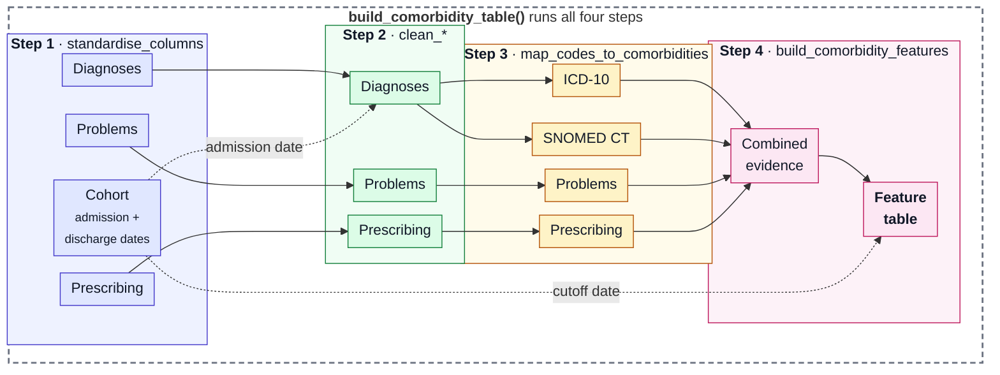

---
hide:
  - toc
---

# Pipeline and cutoff

This page explains what happens inside `build_comorbidity_table()`, how missing
data is handled, and how to choose between an admission and a discharge cutoff.

## The four steps

Every mapped evidence table has **the same five columns** (output of map_codes_to_comorbidities), whatever table it
came from:

| Column | Contains |
|---|---|
| `subject` | The patient |
| `comorbidity_code_value` | The code or medicine name that was looked up |
| `comorbidity_code_source` | Which table it came from, e.g. `diagnoses` |
| `comorbidity` | The Charlson condition, or empty if the code isn't on the list |
| `comorbidity_date` | The date of the evidence |

!!! tip "Stack all evidence tables"
      Because the columns match, the tables can simply be stacked into one long
      table. Feature building does this for you: you pass the evidence tables as a
      list. The combined table is used internally and is not returned.

In steps:

1. **Standardise columns.** Each input table's columns are renamed to the
   package's canonical names, using `column_map` if you gave one. From here
   on, every step uses the same names, whatever your data called them.
2. **Clean.** Each table is cleaned on its own: codes are tidied, identifiers
   turned into text and dates parsed. Diagnoses with no date get a fallback
   date (see [Missing diagnosis dates](#missing-diagnosis-dates)).
3. **Map.** Each code column is mapped to Charlson conditions, giving one
   **evidence table** per source. Every evidence table has the same columns,
   so they can be combined: patient, condition, code, source and date.
4. **Build features.** Evidence from all sources is combined. For each spell
   in the cohort, a condition is flagged `1` if any evidence for that patient
   is dated before the spell's cutoff. Spells with no evidence get all `0`s.
   The score is calculated last.

Your input tables are never changed; each step works on a copy.

## Missing data

iCARE extracts are often incomplete. Diagnosis dates and SNOMED CT diagnosis
codes are often missing, while ICD-10 codes, problem-list dates and
prescribing dates are usually present. The package is designed to use what is
there:

- Any one evidence table is enough to run.
- Diagnoses need ICD-10 **or** SNOMED CT codes, not both.
- Evidence from each source is kept separately until the last step, so a gap
  in one table doesn't affect the others.

### Missing diagnosis dates

A diagnosis with no date can't be compared to a cutoff. When the diagnoses
table includes `spell_identifier`, a missing date is replaced with **the
admission date of that diagnosis's spell**, taken from the cohort. That's a
reasonable estimate: the diagnosis was recorded during that admission, so the
condition was known by then.

Without `spell_identifier`, or if the spell isn't in the cohort, diagnoses
without a date are left out.

## Choosing a cutoff

Evidence only counts if it is dated **strictly before** the cutoff. Evidence
on the cutoff date itself is excluded.

| `cutoff` | Evidence counted | Gains | Loses |
|---|---|---|---|
| `"discharge"` (default) | Before discharge, including during the stay | Long-standing conditions first coded during this admission | May include conditions that started during the stay |
| `"admission"` | Before admission only | Only what was known when the patient arrived | Long-standing conditions first coded during this admission |

!!! warning "Use an admission cutoff for prediction models"
    If the comorbidities are features in a model that predicts an outcome of
    the admission, codes recorded during the stay can carry information about
    that outcome. This is called **leakage**, and it makes a model look better
    than it will be in practice. An admission cutoff avoids it.

Use the default discharge cutoff when you want the fullest description of a
patient's comorbidities, for example to describe a cohort or adjust for
comorbidity burden.

Whichever you choose, report it in your methods.

### How the cutoff interacts with the date fallback

Diagnoses from the **current** spell that had no date are given that spell's
admission date. With `cutoff="admission"`, that date is not *before*
admission, so these diagnoses are excluded. That's intended: they were
recorded during the stay. With `cutoff="discharge"` they count.

Undated diagnoses from **earlier** spells in the cohort get the earlier
admission date, so they count with either cutoff.

## Dates and identifiers

- **Dates** are read one by one, so mixed formats in the same column work.
  Dates with a timezone are converted to UTC. Dates without one are treated
  as UTC. If your dates are local clock times and the offset matters, add the
  timezone before passing them in.
- **Patient and spell identifiers** are turned into text, so `123` and `"123"`
  are the same patient. Leading zeros in text identifiers are kept.
- **SNOMED CT codes** stored as decimals, such as `95443002.0`, are tidied so
  they still match. Long codes that were stored as numbers may already have
  lost digits, which can't be recovered. Read them as text from the start
  (see [Prepare iCARE tables](../how-to/prepare-icare-tables.md)).
